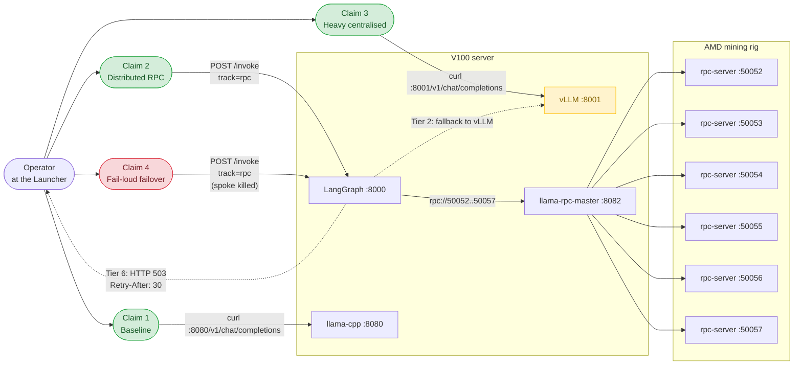
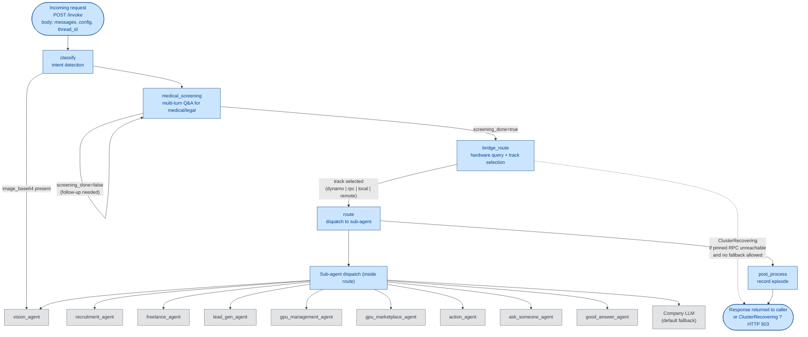
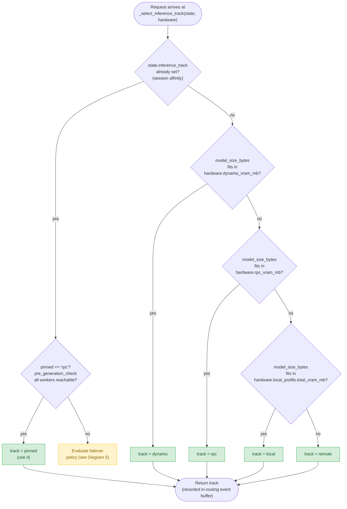
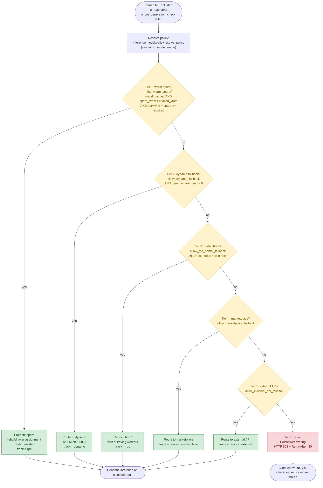
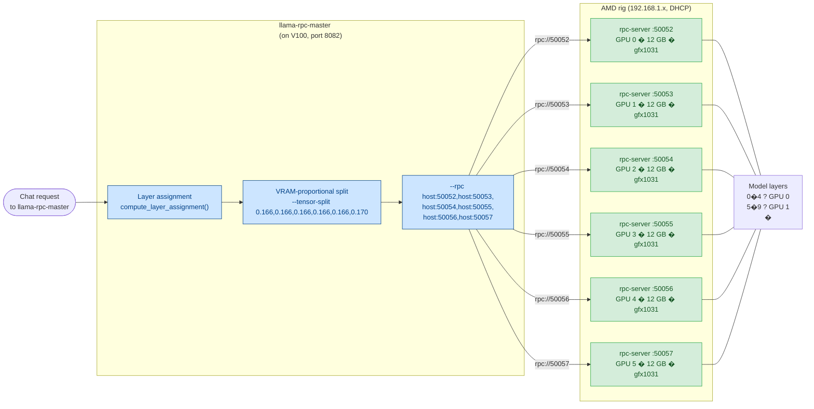
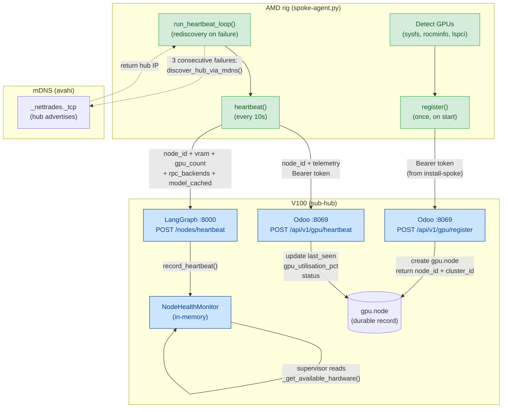
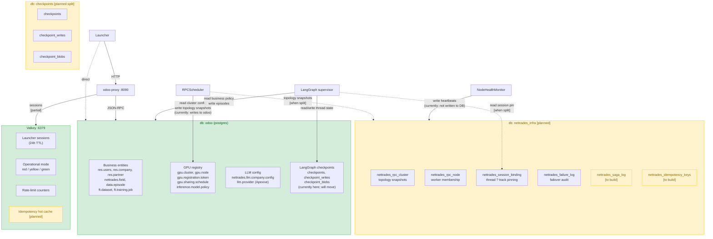
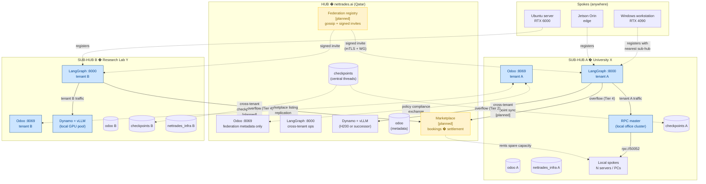

## `docs/developer/architecture.md`

# NETTRADES Architecture � Authoritative Reference

**Status:** This is the canonical architecture document. It supersedes `ARCHITECTURE-AND-PLAN.md` and any `architecture.txt` / `Target Architecture.txt` files in the repository.

**Last updated:** 2026-10-20 � reflects the V100-as-primary-governance-plane topology. Supersedes all earlier diagrams (WSL sub-hub, H200 pool, `dynamo` on port 8000).

**Audience:** A fresh LLM session or human developer who needs to know, in one document, what the system is meant to look like, what it currently looks like, and what the next milestone is.

---

## 1. How to use this document

Read this document **first**, then the current handoff. Then the specific file named for the work item you are tackling. Do not read the whole codebase before acting.

**Reading order in every session:**

1. **This document** � the target shape, the current shape, and what the diagrams mean.
2. **`HANDOFF-YYYY-MM-DD.md`** at the repository root � the most recent session's summary, current state, and specific next actions.
3. **`docs/developer/CURRENT-STATE.md`** � the honest inventory of what exists today.
4. **`docs/developer/DEMO-STATE.md`** � the target for the current milestone.
5. **`docs/developer/TRANSITIONS.md`** � the checklist for the current transition (T1 = Current?Demo).
6. **`docs/developer/FAILOVER-HIERARCHY.md`** � the detailed semantics of the six failover tiers, when you are touching `supervisor.py`, `rpc_scheduler.py`, or `node_health.py`.
7. **`docs/developer/ROLES.md`** � the deployment roles and their installers, when you are deploying a machine.
8. **`docs/developer/FUTURE-STATE.md`** � the roadmap beyond the demo, when you have completed the demo and are starting the next phase.

**Do not read the whole codebase before acting.** The documents above name the specific files for each work item.

**What this document is not:** It is not a deployment guide. It is not a bug catalog. It is not a design rationale (that is `DECISIONS.md`). It is the shape of the system, in pictures, with enough commentary that a reader can reason about what should exist and what should not.

---

## 2. The three states

The platform has three documented states. Every diagram in this document is labelled with which state it describes.

| State | Summary | Governs |
|---|---|---|
| **Current** | What exists today. V100 has Ubuntu; nothing is deployed on it yet. AMD rig has not been reinstalled. WSL sub-hub is stopped. | `CURRENT-STATE.md` |
| **Demo** | The four-claim demo for the Qatar Foundation. V100 = sub-hub + dynamo. AMD rig = spoke. V100 runs the Launcher. | `DEMO-STATE.md` |
| **Future** | Federation, marketplace, multi-tenancy, certification. Five phases after the demo. | `FUTURE-STATE.md` |

**The current milestone** is the transition from Current to Demo. Everything in �3��10 is either what exists (Current) or what the demo will produce. Everything in �11 is aspirational (Future).

**Aspirational components are marked `[planned]`.** A `[planned]` component does not exist in the codebase, or exists as a model with no implementation. Do not mistake a `[planned]` box for shipped software.

---

## 3. Diagram 1 � Physical topology (Current + Demo)

This is the topology as of 2026-10-20, after the V100 becomes the primary governance plane. The demo target is achieved when the four claims in �4 pass.

```mermaid
flowchart TB
    subgraph ROUTER["ZYXEL EX5601-T0 (192.168.1.1)"]
        INTERNET["Fibre WAN 2500M/Full"]
    end

    subgraph SWITCH["ZYXEL XS1930 (2.5G managed switch)"]
        direction TB
    end

    subgraph V100["V100 SERVER � Hewlett Packard Enterprise ProLiant DL580 Gen9"]
        direction TB
        ILO["iLO 4<br/>192.168.1.10 (static)<br/>HTTPS"]
        UBUNTU["Ubuntu Desktop 24.04<br/>192.168.1.212 (DHCP)"]
        GPU_V100["4 � Tesla V100 16 GB<br/>NVLink � 64 GB total"]

        subgraph V100_GOV["Sub-hub (governance plane)"]
            ODOO["Odoo :8069<br/>14 NETTRADES modules"]
            LG["LangGraph Supervisor :8000"]
            PROXY["odoo-proxy :8090"]
            LLAMA["llama-cpp :8080<br/>(single-node baseline)"]
            RPCM["llama-rpc-master :8082<br/>(profile rpc)"]
            PG[("postgres :5432<br/>db: odoo")]
            VK[("Valkey :6379")]
            PROM["Prometheus :9090"]
            GRAF["Grafana :3001"]
            UI["AI Chat UI :3002"]
            LAUNCH["NETTRADES Launcher<br/>(Electron)"]
        end

        subgraph V100_DYN["Dynamo hub (data-centre tier)"]
            VLLM["vLLM :8001/v1<br/>--tensor-parallel-size 4<br/>--dtype half<br/>--enforce-eager"]
        end

        UBUNTU --> V100_GOV
        UBUNTU --> V100_DYN
        GPU_V100 --> V100_GOV
        GPU_V100 --> V100_DYN
    end

    subgraph AMD["AMD MINING RIG � Ubuntu Desktop 24.04"]
        direction TB
        GPU_AMD["6 � Radeon RX 6700 XT<br/>12 GB each � 72 GB total"]
        AGENT["spoke-agent.py<br/>heartbeat � register"]

        subgraph RPC["RPC servers (one per GPU)"]
            R0["rpc-server :50052<br/>HIP=0 � gfx1031"]
            R1["rpc-server :50053<br/>HIP=1 � gfx1031"]
            R2["rpc-server :50054<br/>HIP=2 � gfx1031"]
            R3["rpc-server :50055<br/>HIP=3 � gfx1031"]
            R4["rpc-server :50056<br/>HIP=4 � gfx1031"]
            R5["rpc-server :50057<br/>HIP=5 � gfx1031"]
        end

        GPU_AMD --> RPC
        AGENT --> RPC
    end

    subgraph WSL["WSL DEV PC (retired from demo path)"]
        WSL_STACK["Docker stack: stopped<br/>code intact for development"]
    end

    subgraph CONTABO["Contabo (nettrades.ai � out-of-path)"]
        CONTABO_LLAMA["llama.cpp :8080<br/>remote fallback"]
    end

    INTERNET --> ROUTER
    ROUTER --> SWITCH

    SWITCH -->|2.5G| V100
    SWITCH -->|2.5G| AMD
    SWITCH -->|2.5G| WSL

    ILO -.->|out-of-band management| UBUNTU

    %% Client ? governance plane
    LAUNCH -->|localhost| PROXY
    PROXY -->|JSON-RPC| ODOO
    LG -->|tool calls| PROXY
    LG -->|node inventory| PROXY

    %% Governance plane ? storage
    ODOO --> PG
    LG -->|"checkpoints (currently in odoo)"| PG
    PROXY --> VK

    %% Supervisor ? inference tracks
    LG -->|"track: local"| LLAMA
    LG -->|"track: rpc"| RPCM
    LG -->|"track: dynamo"| VLLM

    %% RPC master ? workers
    RPCM -->|"rpc://50052..50057"| R0
    RPCM --> R1
    RPCM --> R2
    RPCM --> R3
    RPCM --> R4
    RPCM --> R5

    %% Spoke ? governance plane
    AGENT -.->|"POST /api/v1/gpu/register"| ODOO
    AGENT -.->|"POST /api/v1/gpu/heartbeat"| ODOO
    AGENT -.->|"POST /nodes/heartbeat"| LG

    %% Observability
    PROM -.->|scrape| LG
    PROM -.->|scrape| ODOO
    GRAF --> PROM

    %% Remote fallback (not in demo path)
    LG -.->|"remote track (unused)"| CONTABO_LLAMA

    classDef current fill:#d4edda,stroke:#28a745,color:#155724
    classDef planned fill:#fff3cd,stroke:#ffc107,color:#856404
    classDef retired fill:#f8d7da,stroke:#dc3545,color:#721c24
    classDef hub fill:#cce5ff,stroke:#004085,color:#004085

    class UBUNTU,V100_GOV,V100_DYN,AMD,RPC current
    class CONTABO,WSL retired
    class VLLM hub
```




### What this diagram tells you:

* The V100 hosts both the governance plane (Odoo, LangGraph, llama.cpp, RPC master, Launcher) and the dynamo inference tier (vLLM on 8001). This is the "dual role" of the current demo topology. Earlier releases separated these onto two machines; that separation is gone.

* The AMD rig is the spoke. Six rpc-server processes, one per GPU. The RPC master on the V100 connects to all six over rpc://.

* The WSL dev PC is in the diagram only to make clear it is retired from the demo path as a sub hub. Its Docker stack is stopped; the code is untouched. Restarting it during a demo session is a failure mode (see HANDOFF-2026-10-19.md �5.3 and ROLES.md �"Retiring the WSL sub-hub").
    
What the diagram does not show: every internal detail of the governance plane. That is Diagram 3 (supervisor graph), Diagram 5 (failover hierarchy), Diagram 6 (RPC pipeline), and Diagram 8 (data ownership).

## 4. Diagram 2 � The four demo claims

The Qatar Foundation demo is four claims, each with a concrete command and observable result. This diagram shows the runtime path for each claim on the topology from Diagram 1.



Claim 1 � Baseline. One machine, CPU only, llama.cpp on `:8080`. Proves the platform can serve inference from local hardware with no cluster.

Claim 2 � Distributed RPC. The model is served across six AMD GPUs in a pipeline. The path goes LangGraph ? RPC master ? six `rpc-server` processes. The observable proof is rocm-smi --showuse on the AMD rig showing all six GPUs at >0%.

Claim 3 � Heavy centralised. The full-size model runs entirely in VRAM on the V100 cluster, tensor-parallel across four NVLink-connected GPUs. The path goes LangGraph ? vLLM on `:8001` (or direct curl to vLLM, if demonstrating the endpoint independently).

Claim 4 � Fail-loud failover. Kill the AMD spoke mid-session. The next pinned RPC request must either fall back to a same-model track (Tier 2, the V100 vLLM) or fail with HTTP 503 and `Retry-After: 30` (Tier 6). Never silently downgrade to a smaller model.

What to say and what not to say: See �15.

## 5. Diagram 3 � Supervisor graph (internal)

The LangGraph supervisor is a five-node graph. Every request traverses it in order (with one loop back from `medical_screening` when the intent is medical or legal and the initial screening is incomplete). This is the internal shape of the `LG` box in Diagram 1.



Node responsibilities:

| Node | File | What it does |
|---|---|---|
| classify | supervisor.py::classify | Extracts the last user message. Runs a keyword override table first, then the company LLM. Produces state["intent"]. |
| medical_screening | supervisor.py::medical_screening | Multi-turn Q&A for medical/legal intents. Loops back on itself until screening_done=true or MAX_FOLLOWUP_ROUNDS=3. |
| bridge_route | supervisor.py::bridge_route | Calls _get_available_hardware(company_id) ? _select_inference_track(state, hardware) -> sets state["inference_track"]. Raises ClusterRecovering if Tier 6 fires. |
| route | supervisor.py::route | Dispatches to the sub-agent named by state["intent"]. Falls back to the company LLM for unclassified intents. |
| post_process | supervisor.py::post_process | Records the episode for the self-improving loop. Skips recording for remote-routed requests. |

The sub-agent dispatch is inside route, not a graph node. The sub-agents are separate compiled graphs; route calls await sub_agent.ainvoke(state). The dispatch order in supervisor.py::route has one documented quirk � the gpu_marketplace check must come before the gpu_management check, or marketplace requests get routed to the GPU manager. This is fixed in the current code (see the comment in route).

Where the fail-loud policy lives. Only bridge_route can raise ClusterRecovering. The invoke.py route catches it and returns HTTP 503 with Retry-After: 30. Nothing else in the graph blocks, retries, or downgrades on failover. This is invariant #1 in FAILOVER-HIERARCHY.md.

## 6. Diagram 4 � Inference track selection (initial routing)

This is the decision tree inside `_select_inference_track` (called from `bridge_route`). It runs once per request when the thread is not already pinned, and it produces the `inference_track` that the sub-agents will use for the LLM call.



What the numbers mean. Each track has a VRAM budget populated from hardware:

* `dynamo_vram_mb` � total VRAM of all nodes with `inference_capability='dynamo_worker'` (the V100 vLLM, registered by `configure-hub-for-spokes.sh`'s probe).

* `rpc_vram_mb` � total VRAM of all nodes with `inference_capability='rpc_worker'` that the health monitor considers healthy (the AMD rig, once registered).

* `local_profile.total_vram_mb` � the VRAM of the machine the LangGraph container is running on (the V100, via `hardware_detection.py`).

If `model_size_bytes` is not set in state, `classify` defaults it to `4 GiB`. Set `MODEL_SIZE_BYTES` in `.env` to match the served model (default `4683073248` for DeepSeek-R1-7B-Q4_K_M).

Session affinity. Once `state["inference_track"]` is set, all subsequent turns of the same thread go through the pinned branch. The checkpointer persists the state across turns, so the pin survives even a container restart of the sub-agent (though not necessarily of LangGraph itself).

The dynamo track never fires on a fresh WSL deployment. `dynamo_vram_mb` is 0 until `configure-hub-for-spokes.sh` successfully probes the vLLM endpoint and registers a `dynamo_worker`. On the V100 deployment, this works only if `LLM_BASE_URL` is the LAN IP (see `ROLES.md` �"Wire vLLM into LangGraph"). With `localhost`, the probe fails and dynamo is never selected.

## 7. Diagram 5 � Failover hierarchy (six tiers)

When a pinned RPC request arrives, `pre_generation_check` runs first (Diagram 4, `PREFLIGHT` branch). If the check fails � some worker is unreachable, or the surviving cluster cannot hold the model � the supervisor evaluates the six tiers in order.




##### What fires on the current demo topology:

| Tier | Fires? | Why |
|---|---|---|
| Tier 1 � warm spare | No | Only one spoke registered. `_find_warm_spare` returns None. |
| Tier 2 � dynamo fallback | Yes, if `allow_dynamo_fallback=True` and the vLLM probe succeeded | Requires `LLM_BASE_URL=http://192.168.1.212:8001/v1`, not `localhost`. |
| Tier 3 � partial RPC | No by default | `allow_rpc_partial_fallback=False` is the default. Enabling it would need a way to rebuild with fewer workers, which requires the master to survive a partial loss. |
| Tier 4 � marketplace | No | No marketplace. |
| Tier 5 � external API | No by default | `allow_external_api_fallback=False` is the default (data leaves the network). |
| Tier 6 � fail loud | Always | Cannot be disabled. |

The invariant. Tier 6 is terminal. `ClusterRecovering` propagates to the client and does not open the circuit breaker. If it did, a burst of RPC requests would trip the breaker and block all traffic (dynamo, local, remote) for 30 seconds. This is intentional and must not be relaxed.

The demo stance: do not say the failover hierarchy "works". Say it is "designed and testable". It has never fired on real hardware. It fires for the first time when you complete `rehearse-demo.sh` Claim 4 on the V100 + AMD rig.

## 8. Diagram 6 � RPC pipeline topology (per-GPU layer assignment)

The RPC track uses pipeline parallelism. The model's transformer layers are split into contiguous chunks; each chunk lives in the VRAM of exactly one worker. A machine with N GPUs contributes N workers, not one. This is why the AMD rig runs six `rpc-server` processes.



How the split is computed (`rpc_scheduler.py::compute_layer_assignment`):

* Expand each node into one entry per GPU (`gpus` field of `gpu.node`).

* Compute per-GPU capacity as `memory_mb / 1024` (GB).

* `share = cap / total_cap` for each GPU.

* `layers = max(1, round(MODEL_LAYERS * share))`.

* `start_layer`, `end_layer` are contiguous across the sorted GPU list.

* `rpc_split` is normalised so it sums to exactly 1.0 (llama.cpp rejects sums that drift).

The resulting strings are written to `rpc.env` as `RPC_BACKENDS`, `RPC_SPLIT`, and `RPC_N_GPU_LAYERS`, and the master is recreated with `docker compose --profile rpc up -d --force-recreate llama-rpc-master`.

Why the pipeline is per-GPU, not per-machine. A machine with six GPUs does not present one 72 GB device; it presents six 12 GB devices. rpc-server must be started once per device, with `HIP_VISIBLE_DEVICES=<n>` (or `CUDA_VISIBLE_DEVICES=<n>`, or `ONEAPI_DEVICE_SELECTOR=level_zero:<n>`). The `spoke-agent.py` starts one `RpcWorker` per GPU, each with its own environment. If the installer started a single `rpc-server`, only one GPU would be used.

Why HSA override matters. The RX 6700 XT is `gfx1031`. ROCm does not officially support it. Without `HSA_OVERRIDE_GFX_VERSION=10.3.0`, ROCm silently ignores the card and llama.cpp falls back to CPU. The spoke agent sets this env var per worker. If the AMD rig contributes layers but the GPU utilisation stays at 0%, the HSA override did not apply � check `journalctl -u nettrades-spoke | grep HSA`.

## 9. Diagram 7 � Spoke registration and heartbeat paths

A spoke talks to three different endpoints with three different purposes. Confusing them is a common source of "the spoke registered but the platform doesn't see it" bugs.



The three paths:

| Path | Endpoint | Purpose |
|---|---|---|---|
| Register | `POST http://<hub>:8069/api/v1/gpu/register` | Creates a `gpu.node` record. Called once at agent start. Returns `node_id` (used by all subsequent heartbeats) and `cluster_id`. | If the token is expired, register returns 401 and the agent exits. |
| Odoo heartbeat | `POST http://<hub>:8069/api/v1/gpu/heartbeat` | Updates `gpu.node.last_seen`, `gpu_utilisation_pct`, `status`. The durable record. | If it fails, the node stays `state=active` in Odoo but its `last_seen` gets stale. _cron_health_watchdog will eventually mark it offline. |
| LangGraph heartbeat | `POST http://<hub>:8000/nodes/heartbeat` | Updates the in-memory `NodeHealth` in `NodeHealthMonitor`. The real-time signal the supervisor reads. | If it fails, the health monitor's pull probe (TCP to rpc_backends) is the fallback health signal. |

Why both Odoo and LangGraph heartbeats. They serve different concerns. Odoo is the durable record � it survives a LangGraph restart, and it's what the operator sees in the Odoo UI. LangGraph is the real-time signal � it feeds the supervisor's _get_available_hardware(), which sets rpc_vram_mb. If only Odoo heartbeat worked, the supervisor would see the cluster as empty on the next routing decision. If only LangGraph heartbeat worked, a LangGraph restart would lose the node until its next heartbeat.

Why the register path sends subnet_ip rather than public_key. The demo topology uses LAN mode (use_wireguard=false). The spoke registers with its LAN IP; the RPC master connects over plain TCP. WireGuard is present in the code and tested, but it is not part of the demo. See DEMO-STATE.md �1.

Why the mDNS rediscovery path is a risk. If the spoke's heartbeat to the V100 fails three times in a row, _rediscover_hub() calls avahi-browse _nettrades._tcp and returns the first hub it finds. If both the V100 and the WSL dev PC are advertising at that moment, the spoke might find WSL first and register with the wrong hub. This is why the WSL stack must be stopped before the demo (see ROLES.md �"Retiring the WSL sub-hub").

## 10. Diagram 8 � Data ownership (three databases, one Valkey)

The current deployment puts everything in the odoo database. The future splits it into three. The shape below shows both: the [planned] boxes are not yet created.



#### What exists today:

* db: odoo � everything. Business entities, GPU registry, LLM config, and LangGraph checkpoints all in one database.

* Valkey � Launcher sessions (from auth.py, with 24h TTL, thanks to BUG-002 fix) and operational mode (from mode.py).

#### What is planned:

* db: nettrades_infra � the schema exists as init-infra.sql but has never been applied. Four tables are defined in it (nettrades_rpc_cluster, nettrades_rpc_node, nettrades_session_binding, nettrades_failure_log). Two more need to be created (nettrades_saga_log, nettrades_idempotency_keys).

* db: checkpoints � a database name in a config file only. The checkpointer is instantiated against db: odoo today.

#### Why the split matters. The "swap Odoo for Salesforce" story is not marketing. It is the design goal that determines which data lives where:

* Business entities must be in Odoo (or whatever ERP). They are per-tenant and ERP-specific.

* Operational telemetry (heartbeats, saga state, idempotency) must be independent of the ERP. It is the platform's own state.

* Execution state (LangGraph checkpoints) must be independent of the ERP. It is the agent's state, not the customer's.

If all three live in odoo, swapping the ERP is a migration. If they live in three databases, it is a connection-string change. The three-database split is the foundation of the multi-tenant story.

#### What to do, in order (from FUTURE-STATE.md Phase 1):

* Apply init-infra.sql to a new nettrades_infra database.

* Create nettrades_saga_log and nettrades_idempotency_keys.

* Update app.py to hold three connection pools.

* Update node_health.py and rpc_scheduler.py to write operational telemetry to nettrades_infra.

* Point the checkpointer at the checkpoints database.

* Verify with test-swap-erp.sh.

## 11. Diagram 9 � Future federation (post-demo roadmap)

The future state is multi-tenant, federated, with a marketplace. This diagram shows the shape; nothing in it exists today.



Design invariants that must hold in the future state:

* Data stays within the tenant by default. Cross-tenant traffic happens only through the marketplace (renting capacity) or through explicit, admin-configurable federation (signed invites).

* Every spoke belongs to exactly one sub-hub. A spoke can migrate (via registration token reissuance), but it never serves two sub-hubs simultaneously.

* The hub does not hold tenant business data. Its Odoo holds federation metadata and marketplace settlement records, not tenant ORM rows.

* Federation is opt-in. A sub-hub that does not wish to federate must be fully functional on its own. This is already true; keep it that way.

#### What does not exist yet:

* The federation registry (gossip or signed invites).

* Cross-tenant checkpoint sync (the hardest problem in the diagram).

* The marketplace (booking, settlement, policy enforcement).

* Multi-tenant Odoo (one Odoo serving many tenants with isolated data).

* The connector registry (Salesforce, SAP, Oracle adapters, all with [planned] status in FUTURE-STATE.md).

This diagram is the ceiling. Everything before it is the demo. Everything after it is the product. Do not attempt the federation work until the demo has passed and the database split (Phase 1 of the future state) has been applied.

## 12. The invariants that shape every diagram

These are non-negotiable. Every diagram in this document assumes them. If a diagram suggests a change to them, the diagram is wrong, not the invariant.

* Never silently downgrade to a smaller model. A pinned RPC request that finds its cluster unreachable either routes to a same-model fallback (warm spare, Dynamo, partial RPC, marketplace) or fails loudly with HTTP 503. Local single-node llama.cpp is not a failover tier.

* Fail loudly, not quietly. ClusterRecovering propagates straight to the client and does not open the circuit breaker.

* Odoo is the single source of truth for business entities. nettrades_infra (when it exists) holds only operational telemetry.

* Administrators control every fallback that could leak data. allow_external_api_fallback is False by default and opt-in per cluster and per model.

* Session affinity preserves KV cache locality. A conversation pinned to a track stays on that track unless failover is explicitly permitted.

* Every externally facing endpoint requires authentication. No anonymous control-plane endpoints.

* No manual steps in the build. Every artifact the installer depends on is produced by a script that runs as part of the build.

Full text in README.md �Invariants and FAILOVER-HIERARCHY.md.

## 13. Ports, addresses, credentials

### LAN addresses

| Machine | Address | Assigned by |
|---|---|---|
| Router (ZYXEL EX5601-T0) | 192.168.1.1 | Static (factory) |
| Switch (ZYXEL XS1930) | 192.168.1.73 | DHCP |
| V100 server | 192.168.1.212 | DHCP |
| V100 iLO | 192.168.1.10 | Static (set this cycle; was 172.16.4.94 factory) |
| AMD mining rig | DHCP (check router) | DHCP |
| Windows dev PC | 192.168.1.217 | DHCP |
| Contabo | nettrades.ai (DNS) | External |

### V100 ports

| Service | Port | Notes |
|---|---|---|
| Odoo | 8069 | |
| LangGraph | 8000 | |
| odoo-proxy | 8090 |	The Launcher talks to this, not Odoo directly |
| llama.cpp | 8080 |	Single-node baseline (Claim 1) |
| vLLM | 8001 |	Override of vLLM's default 8000. Mandatory � 8000 is LangGraph. |
| RPC master | 8082 |	Only active when the rpc profile is up |
| Prometheus | 9090 |	 |
| Grafana | 3001 |	 |
| AI Chat UI | 3002 |	 |
| iLO | 443 |	On 192.168.1.10 |

### AMD rig ports

| Service | Port | Notes |
|---|---|---|
| rpc-server GPU 0 | 50052 | HIP_VISIBLE_DEVICES=0, HSA_OVERRIDE=10.3.0 |
| rpc-server GPU 1 | 50053 | Same |
| rpc-server GPU 2 | 50054 | |
| rpc-server GPU 3 | 50055 | |
| rpc-server GPU 4 | 50056 | |
| rpc-server GPU 5 | 50057 | |

### Credentials

| What | Where |
|---|---|
| V100 iLO | Administrator / password on the network setup tag on the front of the server |
| V100 Ubuntu | user account chosen at install (admin is typical) |
| V100 Odoo admin | ODOO_ADMIN_PASSWORD in deploy/docker/.env |
| V100 NETTRADES service user | NETTRADES_SERVICE_PASSWORD in .env |
| V100 LangGraph API key | LANGGRAPH_API_KEY in .env |
| V100 vLLM API key | DYNAMO_API_KEY in .env (printed by deploy-v100-vllm.sh) |
| V100 odoo-proxy API key | ODOO_API_KEY in .env (= PROXY_API_KEY) |
| AMD spoke registration token | One-time, printed by configure-hub-for-spokes.sh |

## 14. What is shipped, what is designed, what is planned

### Shipped (verified working on the current deployment)

| Item | Where | Verified by |
|---|---|---|
| Ubuntu Desktop 24.04 on V100 | 192.168.1.212 | ip addr, nvidia-smi (4� V100) |
| iLO 4 | https://192.168.1.10 | Browsable, remote console operational |
| src/core/rpc_scheduler.py (with _find_warm_spare async fix) | git log | ast.parse OK |
| src/core/odoo_proxy/auth.py (with parameter list fix) | git log | ast.parse OK |
| scripts/phase-scale.sh (with COMPOSE_ARGS fix) | git log | bash -n OK |
| WSL sub-hub fully stopped | docker ps -a empty | 	 |

### Designed (code exists, integration tested on WSL, not on the demo hardware)

| Item | Where | Notes |
|---|---|---|
| Full sub-hub Docker stack | scripts/nettrades-setup.sh sub-hub | Has run on WSL; has not run on V100 |
| vLLM deployment | scripts/deploy-v100-vllm.sh | Has run on the Contabo V100 box (different hardware); has not run on this DL580 |
| AMD spoke installer | scripts/install-spoke.sh | Has run on the AMD rig once, but with an old binary name; the current RPC_BIN search will pick up ggml-rpc-server if rpc-server is missing |
| RPC track end-to-end | llama-rpc-master + rpc-server | Never served a request |
| Failover hierarchy | supervisor.py::_select_inference_track | Never fired |

### Planned (code does not exist, or exists as a model with no flow)

| Item | Planned in | Notes |
|---|---|---|
| db: nettrades_infra | init-infra.sql (never applied) | Four tables defined, two missing |
| db: checkpoints split | app.py connection string | Currently in odoo |
| Saga coordinator | odoo_proxy/main.py | No code |
| Idempotency keys | odoo_proxy/main.py | No code |
| Federation registry | FUTURE-STATE.md Phase 2 | No code |
| Marketplace booking | FUTURE-STATE.md Phase 2 | gpu.sharing.schedule model exists; no booking flow |
| External API adapters (OpenAI, Anthropic) | FUTURE-STATE.md Phase 3 | allow_external_api_fallback exists; no adapter |
| Salesforce / SAP / Oracle connectors | FUTURE-STATE.md Phase 3 | ConnectorRegistry exists; only Odoo is wired |
| Multi-tenant Odoo | FUTURE-STATE.md Phase 4 | Not started |
| SOC 2 / ISO 27001 / GDPR certifications | FUTURE-STATE.md Phase 5 | Not started |

## 15. Demo wording � what to say and what not to say

The four claims (�4) are what the demo proves. Everything else is supporting evidence or context.

### Say

* "This is the baseline. One machine, CPU only. It works today." (Claim 1)

* "The model is being served across six GPUs in a pipeline. Watch the worker GPUs." (Claim 2, with rocm-smi --showuse running)

* "The data-centre tier. The full model, entirely in VRAM, tensor-parallel across four NVLink-connected GPUs." (Claim 3)

* "When a spoke fails, the platform evaluates the failover hierarchy. It either promotes a same-model spare, routes to the data-centre tier, or fails loudly with HTTP 503. It never silently downgrades to a smaller model." (Claim 4, with the code visible)

* "The failover hierarchy is designed and testable. It is being exercised live for the first time today."

### Do not say

* "The failover hierarchy works." It has never fired before this session. Say "designed and testable" until Claim 4 passes.

* "The marketplace is up." It is not built. Say "documented as future work."

* "Federation is supported." It is not built. Say "documented as future work."

* "We have multi-tenancy." The demo is single-tenant. Say "single-tenant for this demo; multi-tenant is the next phase."

* "The platform scales to thousands of nodes." The demo has six GPUs on one spoke. Say "the architecture supports it; the demo is a two-machine proof of concept."

* Any specific dollar figure for the company's valuation. Those are internal.

### What to show on the screen

* The Launcher's Dashboard � shows the active track (`dynamo` or `local`, depending on which claim was just run) and the node count.

* The Launcher's Routing tab � shows the routing event ring buffer. After Claim 4, it will show `preflight_fail` then `failover_tier2` or `failover_tier6`. This is the live proof that the failover hierarchy fired.

* `rocm-smi --showuse` on the AMD rig � shows all six GPUs at >0% during Claim 2.

* `docker compose ps` on the V100 � shows 15 containers, all Up.

* `/nodes` curl output � shows the AMD rig's six GPUs with `vram_total_mb=73728` and six `host:port` strings.

## 16. For future context windows � how to use this document

When you start a new session:

* Read this document in full. It is designed to be read linearly.

* Read the current handoff (`HANDOFF-YYYY-MM-DD.md` at the repository root). That tells you the specific work item for this session.

* Read the file named for that work item. Do not read the whole codebase before acting.

* Do not make architectural decisions in this session that are not already in the handoff. If the handoff says "deploy the sub-hub on the V100", deploy the sub-hub on the V100. Do not decide, mid-session, to also build the marketplace.

* Update this document if and only if a diagram is now wrong. Diagrams get updated when the code they describe changes, in the same commit. Never let a diagram drift from the code.

When in doubt: ask the developer. Do not guess. The developer's time is the constraint.

When this document disagrees with `HANDOFF-YYYY-MM-DD.md`: the handoff wins, because it is more recent. Then update this document to match.


## Updated flowchart TB � current code plus future enhancements

```mermaid
flowchart TB
    %% ========================================================================
    %% HUB � cross-tenant services. One per platform.
    %% These are the components a tenant does NOT run. They are shared
    %% infrastructure provided by the platform operator (nettrades.ai).
    %% ========================================================================
    subgraph HUB["HUB � nettrades.ai � cross-tenant shared services"]
        direction LR
        FEDREG["Federation registry [planned]<br/>gossip discovery � signed invites<br/>(mTLS + WireGuard)"]
        MKT["Marketplace [planned]<br/>listing � booking � settlement<br/>(credits � fiat � token)"]
        XCKPT[("Cross-tenant checkpoint sync [planned]<br/>thread recovery across sub-hubs")]
        HBRAIN["Hub inference pool [planned]<br/>Dynamo + vLLM (H200 target)<br/>(Contabo llama.cpp :8080 today)"]
        HWATCH["Federation health watchdog [planned]<br/>cross-tenant node inventory"]
        COMPLY["Compliance [planned Phase 5]<br/>SOC2 � ISO27001 � GDPR � QFC"]
    end

    %% ========================================================================
    %% SUB-HUB � one instance per tenant, � N.
    %% Every sub-hub is self-contained. It functions without the hub.
    %% The � N annotation is the multi-tenant story: this box repeats.
    %% ========================================================================
    subgraph SUB["SUB-HUB � one per tenant � � N"]

        %% -------------------------------------------------------------------
        %% LAYER 4 � User interfaces (entry points)
        %% -------------------------------------------------------------------
        subgraph L4["L4 � User Interfaces � entry points"]
            LAUNCH["NETTRADES Launcher<br/>Electron � installer/"]
            ODOOUI["Odoo Web UI<br/>:8069"]
            CHAT["AI Chat UI<br/>FastAPI :3002<br/>nettrades-ui"]
            REDIR["Redirector<br/>nginx :80 ? 443"]
            FEDUI["Federation Dashboard [planned]"]
        end

        %% -------------------------------------------------------------------
        %% LAYER 3 � Orchestration and gateway
        %% -------------------------------------------------------------------
        subgraph L3["L3 � Orchestration & Enterprise Gateway"]
            direction TB

            subgraph SUP["Supervisor (src/core/)"]
                GRAPH["LangGraph :8000<br/>app.py<br/>classify ? screen ? bridge ? route ? post"]
                HM["NodeHealthMonitor<br/>node_health.py<br/>push + pull probes<br/>/nodes � /nodes/heartbeat"]
                ROUTER["_select_inference_track<br/>failover T1�T6<br/>ClusterRecovering (2026-10-20 fix)"]
                HWDET["HealthMonitor / manifest<br/>from gpu.node + hub-manifest.json"]
                EVENTS["RoutingEvent ring buffer<br/>200-entry deque � _pin_recorded guard<br/>/routing/events"]
                SCHED["RPCScheduler<br/>rpc_scheduler.py<br/>_find_warm_spare async<br/>(2026-10-20 fix)"]
                LLMFAC["LLMFactory<br/>tools/llm_factory.py"]
                INFSEL["make_llm_for_track<br/>tools/inference.py"]
                BRIDGE["BridgeService<br/>bridge_integration.py"]
                SI["SelfImprovingService<br/>self_improving_integration.py"]
            end

            subgraph GATE["Enterprise Gateway (odoo-proxy :8090)"]
                PROXY["odoo-proxy<br/>main.py<br/>JSON-RPC + JSON-2 API"]
                WHITELIST["Model whitelist<br/>BUG-001 fix<br/>res.users blocked"]
                AUTHSVC["Auth + Mode<br/>auth.py � mode.py<br/>Valkey sessions � HAS_REDIS fallback<br/>(2026-10-20 fix)"]
                CONN["Connector Registry<br/>[partial � Odoo only]<br/>src/connectors/"]
                SAGA["Saga Coordinator [planned Phase 1]"]
                IDEM["Idempotency Keys [planned Phase 1]"]
            end
        end

        %% -------------------------------------------------------------------
        %% LAYER 2 � Business systems
        %% -------------------------------------------------------------------
        subgraph L2["L2 � Business Systems (per tenant)"]
            ODOO["Odoo CE 19 (current)<br/>? CE 20 (target)<br/>13 nettrades_* modules<br/>+ llm_openai (Apexive)"]
            POLICY["inference.model.policy<br/>per-model failover overrides"]
            CLUSTERCFG["gpu.cluster � gpu.node<br/>trust_mode � failover toggles<br/>registration tokens"]
            ADAPT["Salesforce � SAP � Oracle<br/>MCP adapters [planned Phase 3]"]
        end

        %% -------------------------------------------------------------------
        %% LAYER 2 � Storage
        %% -------------------------------------------------------------------
        subgraph STORE["L2 � Storage"]
            PGO[("postgres :5432<br/>db: odoo<br/>ORM � policy � clusters")]
            PGI[("postgres :5432<br/>db: nettrades_infra [planned Phase 1]<br/>heartbeats � saga � idem")]
            PGC[("postgres :5432<br/>db: checkpoints [planned Phase 1]<br/>LangGraph state (currently in odoo)")]
            VK[("Valkey :6379<br/>sessions � modes � rate limits")]
        end

        %% -------------------------------------------------------------------
        %% LAYER 1 � Inference fabric
        %% -------------------------------------------------------------------
        subgraph L1["L1 � Inference Fabric"]
            DYN["Dynamo track<br/>vLLM :8001/v1<br/>V100 NVLink � TP=4<br/>--dtype half � --enforce-eager<br/>(H200 target upgrade)"]
            RPCM["llama-rpc-master :8082<br/>pipeline parallel � --rpc"]
            RPCW["RPC spokes � N GPUs<br/>spoke-agent.py<br/>rpc-server :50052..N"]
            LCPP["llama-cpp :8080<br/>single node � CPU or 1 GPU<br/>(baseline)"]
            VENDORS["Mixed vendor RPC (shipped)<br/>NVIDIA CUDA � AMD ROCm gfx1031<br/>+ HSA_OVERRIDE=10.3.0<br/>Intel SYCL (shipped)<br/>Apple Metal [planned]"]
            MKTGPU["Rented GPU [planned Phase 2]<br/>(marketplace tier)"]
            EXTAPI["External API client [planned Phase 3]<br/>OpenAI � Anthropic<br/>(opt-in only)"]
        end
    end

    %% ========================================================================
    %% CROSS-CUTTING � applies to every sub-hub
    %% ========================================================================
    subgraph XC["Cross-cutting"]
        WG["WireGuard<br/>admin :51821 � internal :51820<br/>(code present; not in demo)"]
        OBS["Observability<br/>Prometheus :9090 � Grafana :3001<br/>Loki � Tempo [planned via Grove]"]
        TLS["TLS<br/>Traefik + Let's Encrypt"]
        SECRETS["Secrets<br/>.env + API keys + registration tokens"]
        DOCKER["Docker daemon<br/>(compose project 'docker')"]
    end

    %% ========================================================================
    %% EDGES � hub to sub-hub
    %% ========================================================================
    FEDREG -.->|"signed invite (mTLS+WG)"| BRIDGE
    FEDREG -.->|"signed invite"| FEDUI
    MKT -.->|"rent spare capacity"| MKTGPU
    MKT -.->|"settlement"| ODOO
    XCKPT -.->|"cross-tenant<br/>thread recovery"| PGC
    HBRAIN -.->|"track: remote<br/>(opt-in)"| GRAPH
    HWATCH -.->|"federation health"| HM
    COMPLY -.->|"audit + evidence<br/>(ODK/OCR + data residency)"| ODOO

    %% ========================================================================
    %% EDGES � L4 to L3 (entry points ? orchestration)
    %% ========================================================================
    LAUNCH -.->|"IPC ? docker compose"| DOCKER
    LAUNCH -->|"HTTP /rpc/relaunch<br/>/cluster /tokens /nodes /routing"| GRAPH
    LAUNCH -->|"HTTP /auth /mode"| AUTHSVC
    ODOOUI -->|"HTTP"| ODOO
    CHAT -->|"POST /invoke"| GRAPH
    CHAT -.->|"direct fallback"| LCPP
    REDIR --> ODOOUI
    REDIR --> CHAT
    FEDUI --> FEDREG

    %% ========================================================================
    %% EDGES � L3 internal
    %% ========================================================================
    GRAPH --> HM
    GRAPH --> ROUTER
    GRAPH --> LLMFAC
    GRAPH --> INFSEL
    GRAPH --> BRIDGE
    GRAPH --> SI
    ROUTER --> HWDET
    ROUTER --> EVENTS
    ROUTER --> SCHED
    SCHED -.->|"docker compose<br/>--profile rpc"| DOCKER
    SCHED -.->|"_on_rpc_node_failure<br/>callback (drain + restart)"| HM

    %% ========================================================================
    %% EDGES � L3 to L2 (all via the gateway)
    %% ========================================================================
    GRAPH -->|"tool calls<br/>(JSON-RPC)"| PROXY
    SCHED -->|"read/write<br/>cluster state"| PROXY
    LLMFAC -->|"get_effective_config"| PROXY
    BRIDGE -->|"route_request"| PROXY
    SI -->|"record episode"| PROXY
    HM -.->|"heartbeats [planned Phase 1]"| PGI
    PROXY --> WHITELIST
    PROXY --> AUTHSVC
    PROXY --> CONN
    PROXY --> SAGA
    PROXY --> IDEM
    CONN -->|"JSON-RPC"| ODOO
    CONN -.-> ADAPT

    %% ========================================================================
    %% EDGES � L2 to storage
    %% ========================================================================
    ODOO --> PGO
    POLICY --> PGO
    CLUSTERCFG --> PGO
    SAGA --> PGI
    IDEM --> PGI
    GRAPH -->|"checkpoints<br/>(in odoo today)"| PGC
    AUTHSVC --> VK

    %% ========================================================================
    %% EDGES � L3 to L1 (four tracks; session affinity preserves choice)
    %% ========================================================================
    GRAPH -->|"track: dynamo<br/>(session affinity)"| DYN
    GRAPH -->|"track: rpc<br/>(office pipeline)"| RPCM
    GRAPH -->|"track: local<br/>(single node)"| LCPP
    GRAPH -->|"track: remote_marketplace<br/>(Tier 4)"| MKTGPU
    GRAPH -->|"track: remote_external<br/>(Tier 5)"| EXTAPI

    %% ========================================================================
    %% EDGES � L1 internal (RPC topology + vendor support)
    %% ========================================================================
    RPCM -->|"rpc://50052..5005N"| RPCW
    RPCW --> VENDORS

    %% ========================================================================
    %% EDGES � spoke to hub (three endpoints, three purposes)
    %% ========================================================================
    RPCW -.->|"POST /api/v1/gpu/register<br/>(token auth)"| ODOO
    RPCW -.->|"POST /api/v1/gpu/heartbeat<br/>(durable)"| ODOO
    RPCW -.->|"POST /nodes/heartbeat<br/>(real-time)"| HM

    %% ========================================================================
    %% EDGES � cross-cutting
    %% ========================================================================
    WG -.->|"mesh"| SUB
    OBS -.->|scrape| GRAPH
    OBS -.->|scrape| ODOO
    OBS -.->|scrape| PGI
    TLS -.->|"certs"| REDIR
    SECRETS -.->|"injected"| PROXY
    SECRETS -.->|"injected"| GRAPH
    DOCKER -.->|"runs"| SUB

    %% ========================================================================
    %% STYLING
    %% ========================================================================
    classDef shipped fill:#d4edda,stroke:#28a745,color:#155724
    classDef partial fill:#fff3cd,stroke:#ffc107,color:#856404
    classDef planned fill:#f8d7da,stroke:#dc3545,color:#721c24
    classDef store fill:#cce5ff,stroke:#004085,color:#004085

    class LAUNCH,ODOOUI,CHAT,REDIR shipped
    class FEDUI,FEDREG,MKT,XCKPT,HBRAIN,HWATCH,COMPLY,SAGA,IDEM,ADAPT,MKTGPU,EXTAPI planned
    class CONN partial
    class GRAPH,HM,ROUTER,HWDET,EVENTS,SCHED,LLMFAC,INFSEL,BRIDGE,SI shipped
    class PROXY,WHITELIST,AUTHSVC shipped
    class ODOO,POLICY,CLUSTERCFG,DYN,RPCM,RPCW,LCPP,VENDORS shipped
    class PGO,VK shipped
    class PGI,PGC store
    class WG,OBS,TLS,SECRETS,DOCKER shipped

```



The diagram is designed to be understood in five reads:

* Top band ? entry points. The Launcher, the Odoo web UI, and the AI Chat UI are what a user sees. Everything below exists to serve them.

* Second band ? governance. The supervisor graph, the health monitor, the track router, and the scheduler are the platform's decision-making core. The gateway enforces the model whitelist so business data can never be read by a tool call that isn't supposed to.

* Third band ? business. Odoo holds the tenant's data. gpu.cluster and inference.model.policy hold the failover configuration. Splitting db: nettrades_infra out (planned) makes the ERP swappable.

* Fourth band ? inference. Four tracks, all served from this sub-hub's own hardware or from the spoke fabric: dynamo (vLLM), rpc (the pipeline across N spokes), local (single-node fallback), remote_marketplace / remote_external (opt-in). Failover is enforced at the router; local single-node is never a failover tier.

* Bottom band ? spokes. Every contributing machine runs rpc-server (one per GPU) and a lightweight heartbeat agent. The six AMD GPUs on the demo rig contribute to the pipeline via six processes on ports 50052�50057, each pinned with HIP_VISIBLE_DEVICES and given the correct HSA_OVERRIDE_GFX_VERSION.

The band above the middle (HUB) is what the platform operator runs once for all tenants. The band below (SUB-HUB) is what each tenant runs. The bottom band (spokes) is what each tenant's network contributes. The hub holds no tenant business data; the sub-hub holds no cross-tenant state; the spokes hold no governance state.

Every component is colour-coded: green shipped, yellow partial, red planned. When a red box turns green, the roadmap phase that produced it is complete. When all six hub boxes are green, the platform has reached the final state described in FUTURE-STATE.md


I asked deepseek "Currently the spokes broadcast when they are running and the sub hub picks it up. But then if a machine is switched off during token generation those tokens are lost and the user has to ask the question again. With Windows, when a computer is doing windows updates and you try to switch off it off, it says that windows is being updated do not switch off a machine. In future the nettrades platform code base could possibly be extented to gracefully detect that the machine is being switched off and tells the hub and delays the switch off for 1 minutes, or runs to close the machines after the hub has been told that the machine will be switched off and it gives the hub one minute to move over onto different machines so that it does not fail in the middle of token generation. So that they fail over is even safer. It currently uses checkpoints but if a machine is switched off in the middle of token generation then you may need to ask the question again." and the previous deepseek window designed the solution below:


# Architecture diagram � complete explanation and graceful shutdown extension

This document has three parts:

* What the diagram means, band by band, so a fresh context window can read it without the surrounding conversation.

* What has to change to reach the final state, phase by phase, with the specific file and the specific gap.

* The graceful shutdown extension � research into how Windows and Ubuntu handle shutdown, what the existing NETTRADES code already does, and what would need to be added so that a machine powering off mid-generation does not lose tokens.

## Part 1 � Reading the diagram

The diagram is a single-tenant slice of the final platform. The � N annotations on the sub-hub and the spoke band are not decoration: every box marked � N is repeated once per tenant or once per machine. The hub is the only band that is not repeated. That is the entire multi-tenant story in one picture.

### The four bands, top to bottom

#### Band 1 � HUB. Six shared services. This is what the platform operator (nettrades.ai) runs once, for all tenants. None of it exists in the current codebase. It is the destination, not the starting point. The six services:

| Service | Purpose | Phase  |
|---|---|---|
| Federation registry | Decides which sub-hubs trust each other, issues signed invites | Phase 5 (federation) |
| Marketplace | Listing, booking, settlement | Phase 6 (marketplace) |
| Cross-tenant checkpoint sync | Thread recovery when a conversation moves between sub-hubs | Phase 5 (the hardest problem) |
| Hub inference pool | The H200 dynamo pool that any sub-hub can overflow to | Phase 3+ (currently Contabo llama.cpp is the stand-in) |
| Federation health watchdog | Cross-tenant node inventory and alerting | Phase 5 |
| Compliance | SOC 2, ISO 27001, GDPR, QFC alignment | Phase 7 (deferred) |

The hub holds no tenant business data. It holds federation metadata, marketplace settlement records, and (once built) cross-tenant checkpoint state. The last of those is the reason the problem is hard: the hub is holding a copy of a tenant's conversation, which is a jurisdictional question as much as a technical one.

#### Band 2 � SUB-HUB. Four layers, entry points at the top. This is what a client runs inside their own network. The layers are stacked vertically because that is the direction of dependency:

* L4 � entry points. The Launcher (desktop app), Odoo Web UI, AI Chat UI, Redirector, and the Federation Dashboard [planned]. A user arriving at the system starts here.

* L3 � orchestration and gateway. The supervisor graph (classify ? screen ? bridge ? route ? post), the health monitor, the track router, the scheduler, and the odoo-proxy gateway. The gateway is the only path from L3 to L2 � no supervisor component reads business data except through it, which is where the model whitelist is enforced.

* L2 � business systems and storage. Odoo holds business entities; gpu.cluster, gpu.node, and inference.model.policy hold the failover configuration. db: odoo is the current single database. db: nettrades_infra and db: checkpoints are the planned splits.

* L1 � inference fabric on the sub-hub. Four tracks the sub-hub can serve from its own hardware: dynamo (vLLM on :8001), rpc (the RPC master on :8082, which connects to the spokes), local (llama.cpp on :8080), and the external API client [planned].

#### Band 3 � SPOKES. Every machine that contributes compute. Each spoke runs rpc-server (one process per GPU) and spoke-agent.py (heartbeat and registration). No Odoo, no LangGraph, no database. The spokes are the only band that does work rather than governing it.

The vendor sub-bands are not cosmetic. spoke-agent.py distinguishes vendors because each requires a different pinning mechanism:

| Vendor | Env var | Override | Status |
|---|---|---|---|
| NVIDIA | CUDA_VISIBLE_DEVICES | none | shipped |
| AMD | HIP_VISIBLE_DEVICES | HSA_OVERRIDE_GFX_VERSION (10.3.0 for gfx1031, 11.0.0 for RDNA3) | shipped |
| Intel | ONEAPI_DEVICE_SELECTOR=level_zero:N | none | shipped (not yet exercised) |
| CPU | none | none | shipped |
| Apple | none (Metal) | none | [planned] � detection exists, installer has no -DGGML_METAL=ON path |
| Marketplace rented | same as vendor | same as vendor | [planned] |

#### Band 4 � Cross-cutting. Five components that apply to every band. WireGuard (present in code, not in the demo), Prometheus/Grafana (running today), Traefik and Let's Encrypt (running today), .env + API keys (the substrate), and the Docker daemon (everything runs in containers).

The edges that matter

Only three edges cross a band boundary. Everything else is inside a band.

HUB ? SUB (dashed, all [planned]): federation invite, marketplace booking and settlement, remote-track fallback, cross-tenant thread recovery, federation health. Each dashed edge corresponds to one of the six hub services. When all six are solid, the hub is built.

SUB ? SPOKE: the RPC master's --rpc connections to the spoke workers, on ports 50052..N. One line per vendor for clarity; in reality there are six connections to the six AMD GPUs on the demo rig.

SPOKE ? SUB (consolidated dashed): the register + heartbeat path. Three endpoints, three purposes:

| Endpoint | Purpose | Durability |
|---|---|---|
| POST /api/v1/gpu/register | Creates the gpu.node record; called once at agent start | durable |
| POST /api/v1/gpu/heartbeat (Odoo) | Updates last_seen, gpu_utilisation_pct, status | durable |
| POST /nodes/heartbeat (LangGraph) | Updates the in-memory NodeHealth that the supervisor reads | real-time only |

The three-endpoint split is the reason a spoke can appear "registered" in Odoo but "unhealthy" in LangGraph, or vice versa. Both signals must agree for the supervisor to route to the spoke.
What is shipped vs. planned

The colour coding is load-bearing:

* Green (shipped): the code exists, the deployment scripts exist, and at least the component has been observed to work. Not every green box has been exercised end to end on the demo hardware � that distinction is in CURRENT-STATE.md.

* Yellow (partial): the code exists but is incomplete. The Connector Registry is the only yellow box: AbstractConnector and OdooConnector are real, salesforce.py and sap.py are stubs.

* Red (planned): no code, or code exists as a model with no flow. Every red box has a phase number in FUTURE-STATE.md.

The single most important reading rule: a red box turning green is the definition of progress. When all six hub boxes are green, the platform has reached the final state. When the red boxes inside the sub-hub turn green, the tenant-side platform is complete. When the [planned] spoke boxes turn green, the fabric is complete.

## Part 2 � What has to change to complete the solution

The phases below are the dependency-ordered path from the current code to the final state. Each phase has a specific gap, a specific file, and a specific verification. This is the same sequence as TRANSITIONS.md but stated here so a reader of the diagram can see which red box each phase turns green.

### Phase 0 � Demo stabilisation (current milestone)

The demo runs. The four claims in `DEMO-STATE.md` �4 pass. /invoke returns a real answer, the AMD rig registers six GPUs, the failover hierarchy fires at Tier 2 or Tier 6. No red box turns green in this phase. This phase proves the green boxes already work.

Verification: `scripts/rehearse-demo.sh` exits 0.

### Phase 1 � Database separation

Red boxes turned green: `PGI` (`db: nettrades_infra`), PGC (`db: checkpoints`), `SAGA`, `IDEM`.

Gaps:

* `init-infra.sql` exists but has never been applied. It defines four tables: `nettrades_rpc_cluster`, `nettrades_rpc_node`, `nettrades_session_binding`, `nettrades_failure_log`.

* Two more tables need to be created: nettrades_saga_log, `nettrades_idempotency_keys`.

* `src/core/app.py` holds one connection (DB_URI). It needs three: odoo, `nettrades_infra`, checkpoints.

* `src/core/node_health.py` writes heartbeats to memory only. It needs to write to nettrades_infra (the durable copy is currently in Odoo, but that will move).

* `src/core/rpc_scheduler.py` reads cluster state from Odoo via the proxy. It needs to read from `nettrades_infra` instead, so the ERP is swappable.

* The checkpointer is instantiated against `db: odoo`. It needs to point at `db: checkpoints`.

Verification: `scripts/test-swap-erp.sh` runs the demo against Odoo, then against a mock ERP, and gets identical output for the mock's responses.

Why this is first: the "swap Odoo for Salesforce" story is the platform's differentiator. If business state and execution state share a database, the swap is a migration. Three databases make it a connection-string change.

### Phase 2 � Odoo 20 readiness

No red box turns green. This phase keeps the green boxes green when Odoo upgrades.

Gaps:

* Six `_sql_constraints` blocks need to move to `models.Constraint` (Odoo 20 API).

* `type='json'` ? `type='jsonrpc'` across every controller.

* `nettrades_core/security/nettrades_secrets_security.xml` needs to be removed or rewritten.

* Dead files listed in the handoff �7.2 need to be deleted.

* version in every `__manifest__.py` needs to be bumped.

Verification: `./scripts/nettrades-setup.sh all --force` succeeds against an Odoo 20 base image.

### Phase 3 � Inference fabric extensions

Red boxes turned green: `EXTAPI`, `AP_RPC`.

Gaps:

* External API adapter (Tier 5). `allow_external_api_fallback` is a config flag. No code implements the adapter. The adapter needs to be a new module (`src/core/agents/external_api_agent.py` or similar) that speaks OpenAI-compatible and Anthropic-compatible protocols, and the supervisor's Tier 5 branch in `_select_inference_track` needs to call it.

* Apple Silicon spoke. `scripts/spoke-agent.py::_detect_apple_gpus()` exists and reports the GPU's unified memory budget. `install-spoke.sh` has no Metal build path. Apple Silicon spoke. spoke-agent.py::_detect_apple_gpus()` exists. `install-spoke.sh` has no Metal build path. The gap is the installer: add `-DGGML_METAL=ON` when `HAS_APPLE` is true, and add a `SK_AP` vendor branch to the installer's detection.

* Hub inference pool (H200). The `dynamo` track currently points at the V100 vLLM on the same host. The H200 target is an upgrade of the same track: the same `LLM_BASE_URL` env var points at the H200 pool instead. No code change; a deployment change.

Verification: Tier 5 fires when `allow_external_api_fallback=True` and all local tracks are unavailable. An Apple spoke registers and appears in `/nodes` with `vendor='apple'`.

### Phase 4 � ERP adapters

Red boxes turned green: `ADAPT` (and `CONN` goes from yellow to green).

Gaps:

* `src/connectors/salesforce.py` needs a full implementation: OAuth 2.0, SOQL, the same method surface as `OdooConnector`.

* `src/connectors/sap.py` needs a full implementation.

* A new `src/connectors/oracle.py` needs to be written.

* `ConnectorRegistry` needs to resolve these by name, and the odoo-proxy needs to route by connector type instead of assuming Odoo.

Verification: a tenant configured with `enterpriseBackend='salesforce'` can run the demo against Salesforce instead of Odoo, with no code change in the supervisor.

### Phase 5 � Federation

Red boxes turned green: `FEDREG`, `FEDUI`, `XCKPT`, `HWATCH`.

Gaps:

* Federation registry. No code. Needs a gossip protocol (the developer mentioned OpenTela-style) and a signed-invite flow (mTLS + WireGuard). This is the largest single piece of new code in the roadmap.

* Federation dashboard. No code. Needs an Odoo view and a Launcher tab.

* Cross-tenant checkpoint sync. No code. This is the hardest problem in the roadmap, because it requires the hub to hold a copy of a tenant's conversation state, which is a data-residency question. The design question is jurisdictional before it is technical.

* Federation `health` watchdog. No code. A new service on the hub that polls every sub-hub's /health and raises alerts.

Verification: two sub-hubs on the same network can see each other's marketplace listings and one can rent capacity from the other.

### Phase 6 � Marketplace

Red boxes turned green: `MKT`, `MKTGPU`.

Gaps:

* Listing lifecycle. `gpu.sharing.schedule` model exists. No listing creation, publication, or expiry flow.

* Booking flow. No booking record is created anywhere. Needs a `gpu.booking` model and a controller in the marketplace service.

* Settlement. `gpu.cluster.platform_fee_percent` exists (default 5%). No payment code. Needs three paths: internal credits (simplest, demo-first), fiat (Stripe), token (USDC on Solana).

* Routing. A booked node needs to appear in `/nodes` with `role='rpc_worker'` so the health monitor sees it. Today the health monitor only sees registered spokes; a rented node is registered the same way, so this may be a code change in `_load_node_inventory_into_monitor` to also read marketplace bookings.

Verification: a booking from a fresh sub-hub serves a real inference request, and settlement is recorded.

### Phase 7 � Compliance

Red box turned green: `COMPLY`.

Gaps: not code. SOC 2 Type II, ISO 27001, GDPR/UK GDPR, and QFC regulatory alignment are evidence programs. They require the platform to be stable, which is why they are last.

Verification: an external auditor's report.

##### Summary table

| Phase | Red boxes turned green | Hardest item |
|---|---|---|
| 0 | none | The demo itself |
| 1 | `PGI`, `PGC`, `SAGA`, `IDEM` | Three connection pools in `app.py` |
| 2 | none | Odoo 20 `models.Constraint` migration |
| 3 | `EXTAPI`, `AP_RPC`, `HBRAIN` | External API adapter |
| 4 | `ADAPT`, `CONN` | Salesforce/SAP/Oracle connectors |
| 5 | `FEDREG`, `FEDUI`, `XCKPT`, `HWATCH` | Cross-tenant checkpoint sync |
| 6 | `MKT`, `MKTGPU` | Settlement |
| 7 | `COMPLY` | The evidence program |

## Part 3 � Graceful shutdown extension: research and design

This is the gap you identified: if a spoke is switched off mid-generation, the tokens generated so far are lost and the user has to re-ask. The checkpointer preserves the conversation up to the last checkpoint, but not the tokens generated since. The solution is to give the spoke time to notify the hub and finish or checkpoint its work before it powers off.

#### How Windows handles shutdown

Windows distinguishes between a GUI application and a service, and offers different notification paths for each.

GUI applications receive `WM_QUERYENDSESSION` when shutdown begins. The application can return FALSE to block the shutdown, but since Windows Vista the ability to block is severely restricted � the system will only wait about 5 seconds before forcing the shutdown, and the user always has the option to force it regardless. The recommended pattern is to return `TRUE` immediately (signalling "I am ready") and do the cleanup in the `WM_ENDSESSION` handler, which is called after the shutdown is committed. The cleanup window is about 5 seconds for a GUI app.

Services receive `SERVICE_CONTROL_SHUTDOWN` with a default grace period of about 20 seconds. The service can call `RequestAdditionalTime(milliseconds)` to request more, and the system honours the request up to a total of 125 seconds across all services. For a longer window, a service can declare `SERVICE_ACCEPT_PRESHUTDOWN` and receive `SERVICE_CONTROL_PRESHUTDOWN` earlier than other services, with its own configurable timeout via `SERVICE_CONFIG_PRESHUTDOWN_INFO`.

`ShutdownBlockReasonCreate` registers a string that appears on the "this app is preventing shutdown" screen. It does not reliably block the shutdown � the user can override � but it is the correct way to tell the user why the app needs a moment.

The constraint that matters for NETTRADES: a Windows service can get up to 125 seconds of additional time, which is enough for a 60-second drain plus margin. A GUI application cannot; it gets about 5 seconds. So the spoke agent on Windows must run as a service, not as a GUI process. The existing Go service `nettrades-netsvc` is already a Windows service and already has a `preshutdown` path (`SERVICE_ACCEPT_PRESHUTDOWN` is available in the Windows service framework). It can be extended to call the spoke agent's drain endpoint before the agent is killed.

#### How Ubuntu/systemd handles shutdown

systemd stops services in reverse dependency order. A service's shutdown behaviour is controlled by three unit-file directives:

* `ExecStop=` runs when the service is stopped, including on shutdown. If `ExecStop` is defined, systemd runs it instead of sending `SIGTERM` directly. This is the hook that lets a service do work before it dies.

* `TimeoutStopSec=` is how long systemd waits for ExecStop to finish (and for the process to exit). The default is 90 seconds on Ubuntu 24.04. If the timeout is exceeded, systemd sends `SIGTERM`, then `SIGKILL`.

* `Before=shutdown.target` and `Conflicts=shutdown.target` ensure the service is stopped before the shutdown proceeds. Without these, the service may be stopped late, after filesystems begin to unmount, and network calls may fail.

A oneshot service with `Before=shutdown.target` can deliberately delay the shutdown: the system will wait for the oneshot's `ExecStop` to complete before proceeding. The pattern is:

```ini

[Unit]
Description=NETTRADES spoke graceful drain
DefaultDependencies=no
Before=shutdown.target
Conflicts=shutdown.target

[Service]
Type=oneshot
ExecStart=/bin/true
RemainAfterExit=yes
ExecStop=/opt/nettrades/spoke/graceful-drain.sh
TimeoutStopSec=90

[Install]
WantedBy=multi-user.target
```


`graceful-drain.sh` does the work: notify the hub, wait for in-flight requests to finish (or checkpoint), then exit. The `TimeoutStopSec=90` gives the script 90 seconds, which is more than enough for a 60-second drain plus network calls.
What the existing NETTRADES code already does

`scripts/spoke-agent.py` already has a signal handler that fires on `SIGTERM` and `SIGINT`:

```python

def _shutdown(*_a):
    logger.info("shutting down")
    self.running = False
    self.rpc.stop_all()
    if self.use_wireguard:
        wg_down()

signal.signal(signal.SIGTERM, _shutdown)
signal.signal(signal.SIGINT, _shutdown)
```

On Linux, systemd sends `SIGTERM` when the service is stopped. The agent catches it, stops the RPC workers, and exits. The gap is that it does not tell the hub it is going away. The hub only notices when the next heartbeat fails, which is up to 10 seconds later, and by then the node is already gone.

On Windows, the agent runs as a plain Python process (started by the installer), not as a service. It receives neither `WM_ENDSESSION` nor `SERVICE_CONTROL_PRESHUTDOWN`. It is killed by the OS with no notification at all.
The proposed design

Three changes, in order of increasing scope. The first is a one-hour change; the third is a multi-day change.
Change 1 � Add a `draining` state to the heartbeat protocol (the critical fix)

What: Before the agent stops its RPC workers, it sends one final heartbeat with `"is_available": false` and `"draining": true`.

Where: `scripts/spoke-agent.py::_shutdown`. Add a `self.heartbeat(draining=True)` call before `self.rpc.stop_all()`.

How the hub reacts:

* `src/core/app.py::node_heartbeat` accepts an optional `draining: bool` field on `_HeartbeatRequest`. It passes it to `monitor.record_heartbeat(..., draining=True)`.

* `src/core/node_health.py::NodeHealth` gets a new field `draining: bool = False`. `record_heartbeat` sets it. `is_node_healthy` returns False if draining is true.

* src/core/supervisor.py::_get_available_hardware` already filters on `get_healthy_nodes_by_role('rpc_worker')`. A draining node is not healthy, so it drops out of `rpc_nodes` automatically. No supervisor change needed.

What this buys: the moment the spoke decides to shut down, the hub stops routing new requests to it. In-flight requests on that spoke still complete (the RPC master does not kill them), but new requests go elsewhere. The token generation that was already running is not interrupted.

What it does not buy: if the spoke is powered off without warning (power cut, forced reset), this change has no effect. That is why Changes 2 and 3 exist.

Verification: `systemctl stop nettrades-spoke` on the AMD rig, then immediately `curl http://localhost:8000/nodes` on the V100. The node should show `is_healthy: false` within one heartbeat interval (10 seconds), not 30 seconds.

Change 2 � Give the OS time to let the drain complete

On Ubuntu: add an `ExecStop` and `TimeoutStopSec` to the `nettrades-spoke.service` unit file that `install-spoke.sh` writes.

```ini

[Service]
Type=simple
ExecStart=/usr/bin/python3 /opt/nettrades/spoke/spoke-agent.py --config /etc/nettrades/spoke/config.yaml
ExecStop=/opt/nettrades/spoke/graceful-drain.sh
TimeoutStopSec=90
Restart=always
RestartSec=10
```
graceful-drain.sh:

```bash

#!/bin/bash
set -euo pipefail

# 1. Tell the hub we are draining. The agent does this on SIGTERM, but
#    doing it again here guarantees it happens even if the agent is
#    already dead (e.g. crashed).
HUB="${HUB_HOST:-192.168.1.212}"
TOKEN="$(grep registration_token /etc/nettrades/spoke/config.yaml | cut -d: -f2- | tr -d ' ')"
curl -sf -X POST "http://${HUB}:8069/api/v1/gpu/heartbeat" \
    -H "Authorization: Bearer ${TOKEN}" \
    -H "Content-Type: application/json" \
    -d '{"node_id": 0, "is_available": false, "draining": true}' || true

# 2. Give in-flight requests a moment to finish. The agent's own
#    SIGTERM handler stops the RPC workers; this sleep lets the
#    master finish the current generation before the workers die.
sleep 30

# 3. The agent's SIGTERM handler has already run. Exit cleanly.
exit 0

```

The `TimeoutStopSec=90` gives the script 90 seconds. The `sleep 30` is the grace window. If a generation is still running after 30 seconds, it is lost � but that is the trade-off, and 30 seconds is longer than most generations on the demo model.

On Windows: the spoke agent must run as a service. There are two paths:

Option A � extend the existing Go service (`nettrades-netsvc`). The Go service already runs as `LocalSystem` and already has a named-pipe server. It can be extended to:

* Register with `SERVICE_ACCEPT_PRESHUTDOWN`.

* On `SERVICE_CONTROL_PRESHUTDOWN`, send the drain heartbeat to the hub.

* Call `RequestAdditionalTime(60000)` to get 60 seconds.

* Wait for the Python spoke agent to exit (or kill it after 60 seconds).

This is the cleanest path on Windows, because the Go service is already the Windows-native component and is already trusted with `LocalSystem`. It is a one-day change to `nettrades-netsvc/main.go` plus a small addition to the pipe protocol (a `drain` command).

Option B � a PowerShell shutdown script registered via Group Policy. Windows allows shutdown scripts to run before services are stopped. A PowerShell script can send the drain heartbeat, wait 60 seconds, and exit. This is less reliable than Option A (Group Policy scripts can be disabled by the user, and the script runs after the user has already clicked "shut down"), but it requires no code changes.

For the demo and the near-term, Option B is sufficient. For the final state, Option A is the correct design.

Change 3 � Checkpoint mid-generation (the hardest fix)

Changes 1 and 2 protect against graceful shutdown. They do not protect against a power cut, a kernel panic, or a forced reset. For those, the only defence is to checkpoint more often than the model generates a full response.

What llama.cpp currently offers: in-memory context checkpoints. `-ctxcp` (default 32) and `-cms` (default 8192) control them. But they are in GPU memory; they do not survive a power loss. Disk-backed checkpoints (`--cache-disk`) are an open feature request (llama.cpp issue #20697) with no maintainer reply as of 2026-07-17.

What this means for NETTRADES: there is no way to resume a partial generation from disk today. The only defence against a power cut is to make the generation short enough that losing it is cheap. That is a prompt design choice, not a code change.

A future option: if llama.cpp adds disk-backed checkpoints, the supervisor could resume a generation from the last checkpoint after a failover. That would require:

* The spoke agent to periodically flush the checkpoint to disk.

* The hub to know where the checkpoint lives (a new field on `gpu.node`).

* The failover hierarchy to route to a node that can read the checkpoint.

None of that exists. It is a Phase 3+ enhancement, and it depends on an upstream feature that has not been implemented. Do not attempt this until the upstream issue is closed.

Summary of the graceful shutdown design

| Change | Effort | Protects against | Depends on |
|---|---|---|---|
| 1. `draining` heartbeat | one hour | Graceful stop (`systemctl stop`, normal shutdown) | none |
| 2. `ExecStop` + `TimeoutStopSec` (Ubuntu) | one hour | The drain completing before the OS kills the process | change 1 |
| 2. `PRESHUTDOWN` in the Go service (Windows) | one day | The drain completing on Windows | change 1 |
| 3. Disk-backed checkpoints | blocked on upstream | Power cut, forced reset | llama.cpp #20697 |

For the Qatar Foundation demo, Change 1 is the one that matters. It makes the failover hierarchy safe: when a spoke is stopped for the Claim 4 demonstration, the hub stops routing to it within one heartbeat, and the in-flight request either finishes on the spoke or fails over to Tier 2 without losing the conversation. The user experience is: "the spoke went away, the platform fell back, the conversation continued." That is the claim.

Changes 2 and 3 are for the production state, after the demo. They belong in `FUTURE-STATE.md` as an addendum to Phase 3 (inference fabric extensions), not in the current milestone.